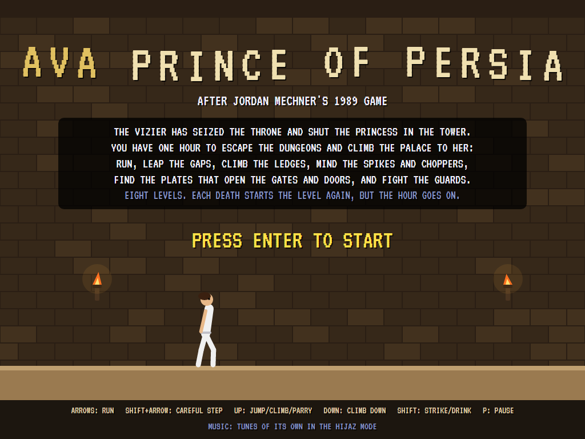
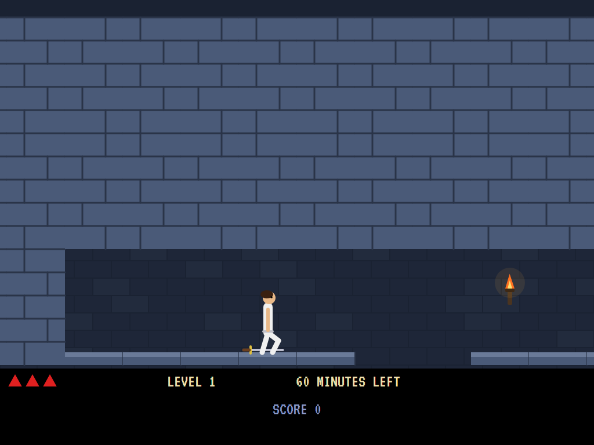
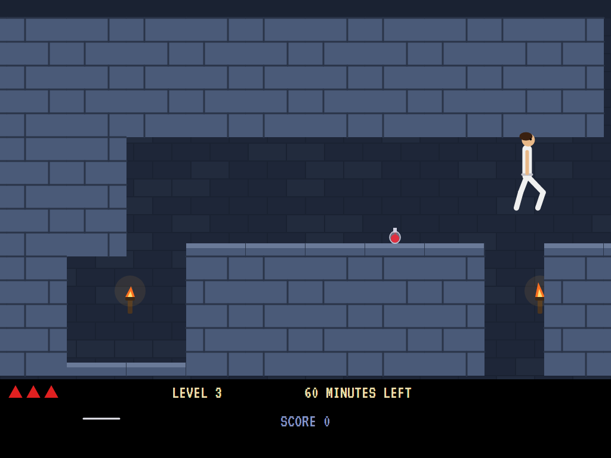
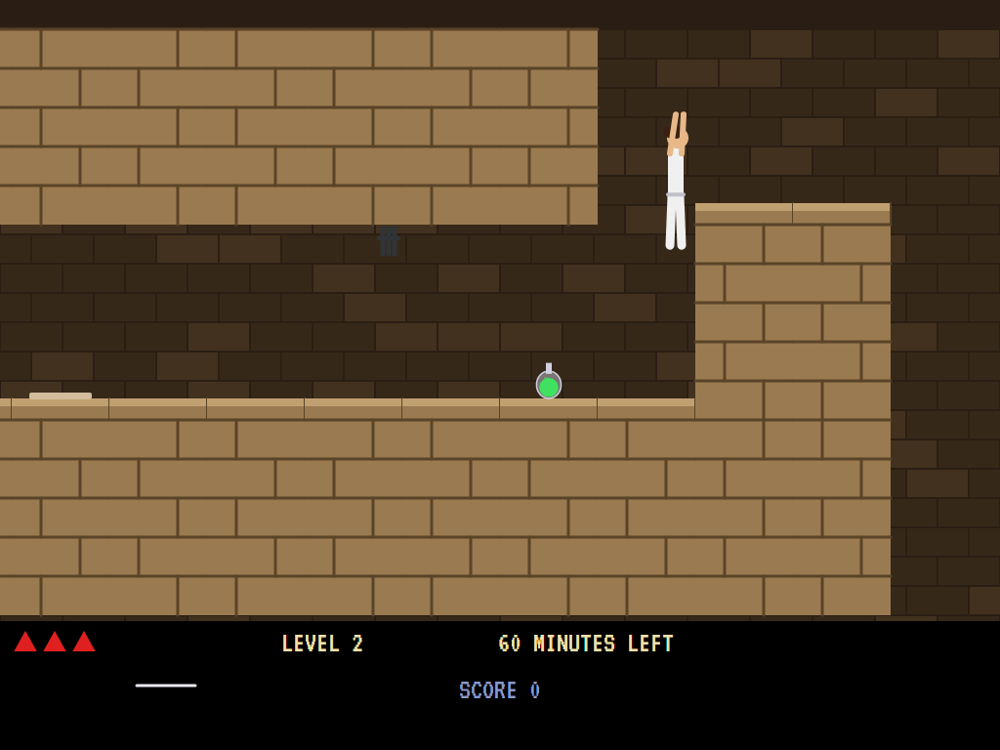
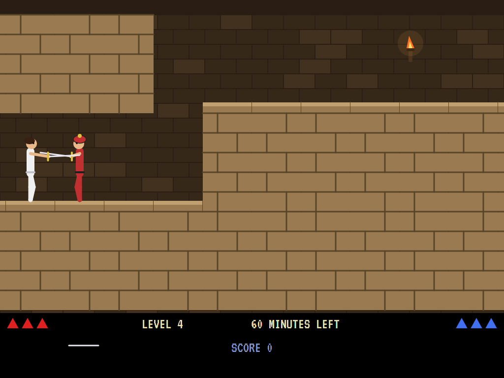
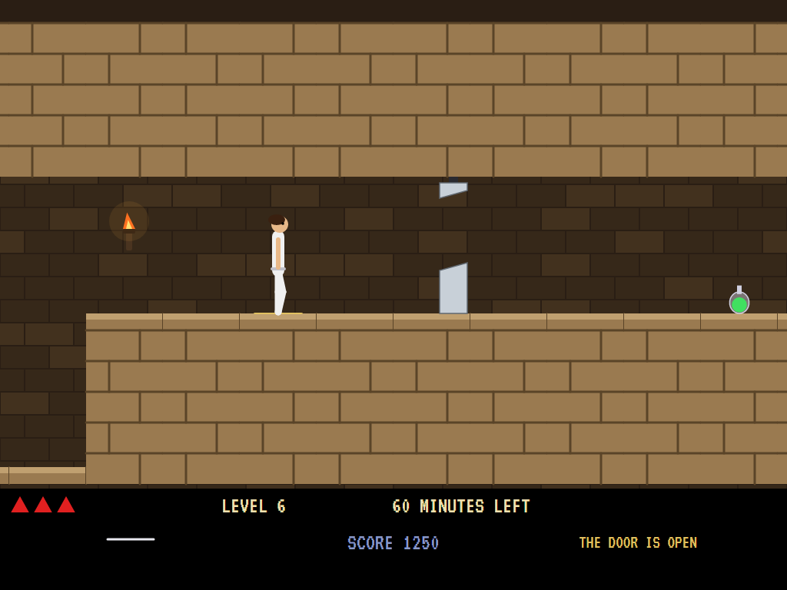
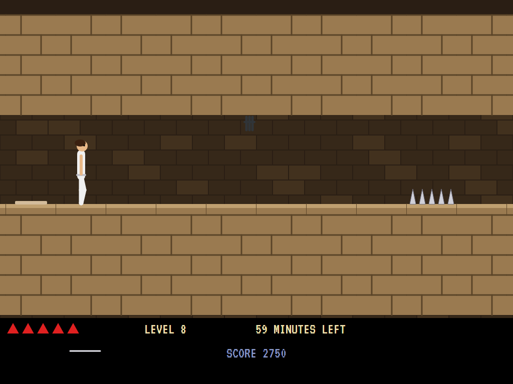
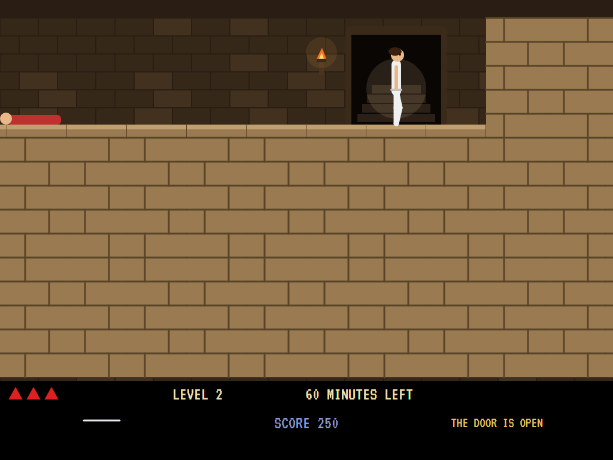
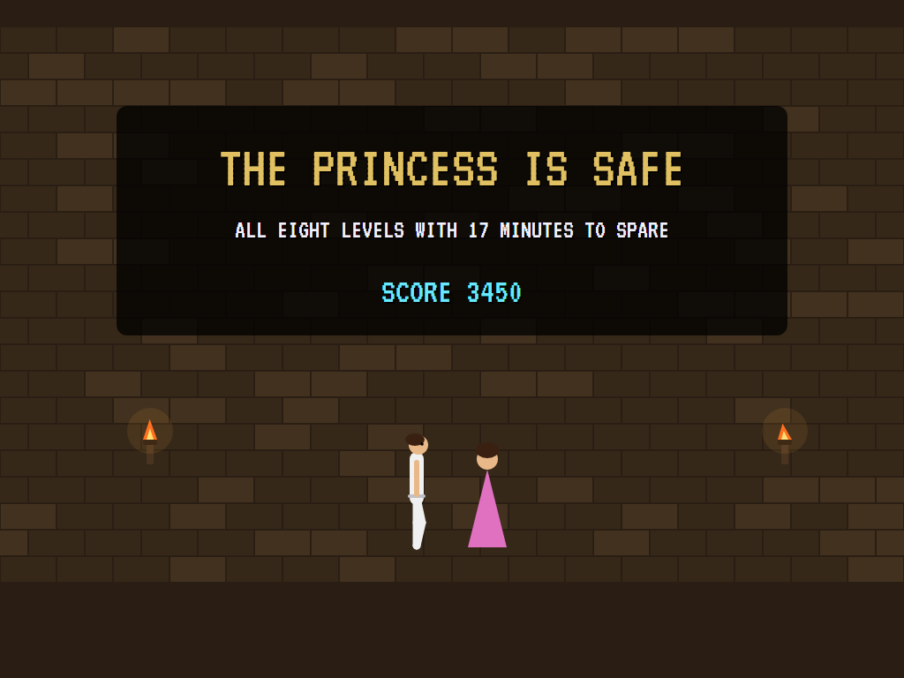

# AVA Prince of Persia

[](https://github.com/Harlock123/AVAPrince/actions/workflows/build.yml)

A palace escape in the style of Jordan Mechner's 1989 game **Prince of Persia**, built with .NET 10 and Avalonia
UI. The vizier has seized the throne and shut the princess in the tower. You have one hour to escape the dungeons
and climb the palace to her: eight levels of gaps, ledges, spikes, choppers, loose floors, gates and guards.

## Features

- **Eight levels**, dungeon and palace in turn, four to seven rooms long, each three storeys high. A level is
  built along a path from the start to the door. Along it are runs of floor, gaps to leap, ledges to climb,
  drops to climb down, and the plate somewhere that opens the door. A level is kept only if the door can be
  reached on the map of the prince's moves.
- **Deliberate movement**, as in the original: every move is an act of a set length on a grid of squares.
  Run a square at a time, or step carefully (a careful step never goes over an edge). Make a standing jump
  over one square, or a running jump over two. Jump up to catch a ledge, hang, and climb, or climb down
  over an edge. Turning takes a moment too.
- **Falls:** one storey is nothing, two cost strength, three are the end.
- **Traps:** spikes kill anyone who runs, jumps or falls onto them, but a careful step is safe. Loose floors
  shake and fall a moment after they're trodden on. Choppers' blades shut every couple of seconds. Gates
  open from their pressure plates and come down again after twelve seconds.
- **Potions:** red ones bring back strength, and the big green ones add to it. The sword is found on the
  first level.
- **Sword fights:** guards come on, strike and parry. Parry a strike as it comes (Up) and strike back
  (Shift) when the guard is open; better guards parry more often. Without a sword, a guard kills you at once.
- **The hour:** each death starts the level again, but the clock runs on. Score 1,000 a level and 250 a guard,
  plus 100 for every minute to spare at the end.
- **The attract mode** shows the computer prince at work. It knows every square it can stand in and where
  each move takes it, and makes for the sword, then the door's plate, then the door; a shut gate on the way
  sends it to the gate's plate first. Before each move it plays the move out on a copy of the level, with
  the move after it, and waits for the moment it's safe. Facing a guard, it parries his strikes as they
  come and strikes back when he's open.

## Screenshots

| The title | The sword | A running jump |
|:---------:|:---------:|:--------------:|
|  |  |  |

| Climbing | A sword fight | A chopper |
|:--------:|:-------------:|:---------:|
|  |  |  |

| A gate | The door | The princess |
|:------:|:--------:|:------------:|
|  |  |  |

The screenshots are made by the tests, which play the game in a real (headless) window; see
[Tests](#tests).

## Download and run

Ready-to-run builds for Windows, macOS and Linux, on both Intel/AMD and ARM, are on the
[Releases page](https://github.com/Harlock123/AVAPrince/releases/tag/latest). **Latest build** is
rebuilt on every push to `main`. Each download is one self-contained executable: no .NET install is
needed.

| Platform | Archive |
|---|---|
| Windows | `AVAPrince-win-x64.zip`, `AVAPrince-win-x86.zip`, `AVAPrince-win-arm64.zip` |
| macOS | `AVAPrince-osx-arm64.tar.gz` (Apple silicon), `AVAPrince-osx-x64.tar.gz` (Intel) |
| Linux | `AVAPrince-linux-x64.tar.gz`, `AVAPrince-linux-arm64.tar.gz`, `AVAPrince-linux-arm.tar.gz` |

```bash
tar -xzf AVAPrince-linux-x64.tar.gz     # or linux-arm64, linux-arm, osx-arm64, osx-x64
./AVAPrince
```

On Windows, unzip and run `AVAPrince.exe`. On macOS, if Gatekeeper refuses to open it, run
`xattr -d com.apple.quarantine AVAPrince` once. Run with `--no-audio` for silence.

**Sound** comes through OpenAL Soft, built in for every platform. In a virtual machine the game
detects it and uses a larger audio buffer, so the sound doesn't break up.

**Gamepads** use SDL2, which is bundled for Windows, macOS and Intel/AMD Linux. ARM Linux builds need it
installed; without it the keyboard still works:

```bash
sudo apt install libsdl2-dev            # Debian / Ubuntu / Raspberry Pi OS
sudo pacman -S --needed sdl2-compat     # Arch / Omarchy
```

## Controls

| Action | Keyboard | Gamepad |
|---|---|---|
| Start | Enter or 1 | Start |
| Run | Left/right arrows (or A/D) | Left stick / D-pad |
| Careful step | Shift with left or right | X or B with left or right |
| Jump (with a direction: a jump across; running: a running jump) | Up (or W) | A or up |
| Hang on, climb up / parry | Up | A or up |
| Climb down an edge / crouch | Down (or S) | Down |
| Strike / drink / pick up | Shift, Space or Ctrl | X or B |
| Through the door (when it's open) | Up | A or up |
| Pause | P or Esc | Start |
| Sound on/off | M | |
| Screenshot | Ctrl+S (to your Pictures folder) | |

On the high-score table, type your initials, or use up/down and Space, then Enter.

## Tests

```bash
dotnet test AVAPrince.slnx
```

The game runs in fixed 60 Hz steps, so it plays the same at any frame rate. Everything that changes lives in
one world that can be copied. The tests check:

- **The levels:** the same from the same seed, and longer level by level; every one with its door and the
  door's plate, the door within reach, and every gate's plate a plate; the sword on level 1.
- **Moving:** running a square at a time, and bumping into walls; a careful step stopping at an edge where a
  run goes over; a running jump clearing two squares, a standing jump one; up to a ledge, hanging, climbing,
  and down again; falls of one, two and three storeys.
- **Traps:** spikes and a careful step; a loose floor falling with the prince on it, and run over safely; a
  chopper; a plate opening its gate for a while; the door opening from its plate; potions and the sword.
- **Guards:** a guard coming on and striking, and parries stopping him; strikes wearing a guard down; no
  sword, no chance.
- **The game:** a death starting the level again with the clock running on; through the door to the next level,
  and the hour running out; the demonstration and high scores; pause; a copied world; the keys.
- **The computer prince:** through all eight levels; just running and jumping gets nowhere.

`tests/AVAPrince.Tests/PilotProbe.cs` reports how the computer prince gets on, level by level, for tuning
(`PRINCE_PROBE=1`). It gets through all eight without a death in a little over four minutes.
`PRINCE_PROBE=lazy` runs right and jumps now and then, and dies at the first gap.

The screenshot tests draw the real screen in a headless window. To refresh the README's pictures:

```bash
PRINCE_SHOTS=$PWD/Images dotnet test tests/AVAPrince.Tests --filter ScreenshotTests
```

## Building

```bash
dotnet build AVAPrince.slnx
dotnet run --project src/AVAPrince
```

Needs the .NET 10 SDK. The sounds, music and cries are made by `tools/make_sounds.py` (standard-library
Python, with the formant voice in `tools/speech.py`): `python3 tools/make_sounds.py` rewrites
`src/AVAPrince/Sounds`.

## Project structure

```
AVAPrince/
├── AVAPrince.slnx
├── src/AVAPrince/
│   ├── Engine/
│   │   ├── GameEngine.cs        # States, levels, the hour, the score, the demonstration
│   │   ├── Sim.cs               # The acts step by step: moving, falling, traps, plates, gates, fighting
│   │   ├── Palace.cs            # The eight levels, built along their paths and proved
│   │   ├── Graph.cs             # Every square the prince can stand in, and where each move takes him
│   │   ├── World.cs             # Everything that changes, kept together so it can be copied
│   │   ├── Pilot.cs             # The computer prince (the demonstration, and the tests)
│   │   ├── HighScoreTable.cs, InitialsEntry.cs
│   │   ├── InputHandler.cs, ControllerManager.cs  # Keys and an SDL2 gamepad
│   │   └── SoundManager.cs      # Effects, music and cries through OpenAL
│   ├── Audio/                   # The OpenAL engine (from the author's AVABand)
│   ├── Views/GameCanvas*.cs     # The rooms, the prince and guards, the strip along the bottom, the title
│   └── Sounds/                  # The synthesised effects, music and cries
├── tests/AVAPrince.Tests/       # Gameplay and screenshot tests
├── tools/make_sounds.py, tools/speech.py
└── Images/                      # Screenshots
```

## About and licence

AVA Prince of Persia © 2026 Lonnie Watson, under the [MIT License](LICENSE).

*Prince of Persia* © 1989 Jordan Mechner, published by Brøderbund; the name *Prince of Persia* belongs to its
current owner. AVA Prince of Persia is an independent, unofficial game in its style. Its levels, graphics,
sounds, music and code are its own; nothing is taken from the original game's program, levels, graphics,
sound or music. It is not affiliated with or endorsed by any rights holder.
